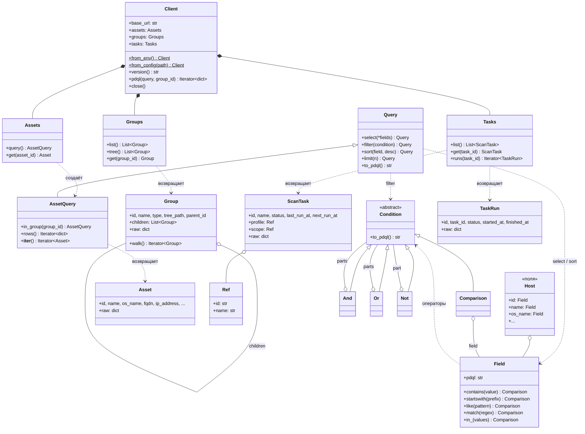
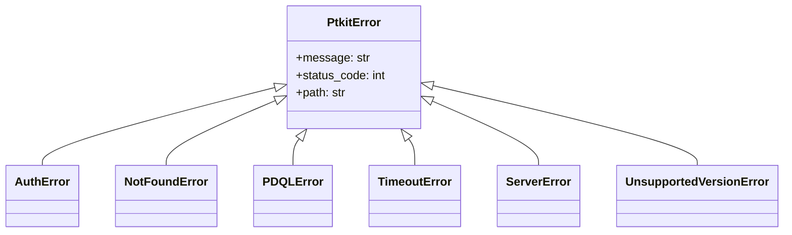

# Архитектура ptkit

Пакет разделён на общую часть (транспорт, ошибки, PDQL) и модули продуктов (`ptkit.vm`).
Общая часть ничего не знает о конкретном продукте. Всё, что зависит от версии MaxPatrol,
находится в `ptkit/vm/_compat.py`.

```text
ptkit/
    __init__.py      публичные исключения, __version__
    errors.py        PtkitError и наследники
    _http.py         сессия requests, TokenAuth / PasswordAuth, повторы, разбор ошибок
    _toml.py         чтение ptkit.toml (tomllib или встроенный разборщик для 3.9–3.10)
    pdql/            Field, Condition, Query, экранирование значений
    vm/
        client.py    Client: from_env(), from_config(), version(), pdql()
        assets.py    Host, Asset, AssetQuery, mp.assets
        groups.py    Group, mp.groups
        tasks.py     ScanTask, TaskRun, mp.tasks
        _models.py   Ref, разбор дат
        _compat.py   эндпоинты, имена полей, форматы ответов MaxPatrol
```

Путь PDQL-запроса: `AssetQuery.to_pdql()` -> `Client._pdql_rows()` ->
`POST assets_grid` (PDQL-токен) -> `GET assets_grid/data` постранично -> `Asset.from_row()`.

## Публичные классы

Ручная схема: только публичные классы и связи между ними.

<!-- manual:start -->



<!-- manual:end -->

## Сгенерированная схема

Генерируется `pyreverse -o mmd -p ptkit ptkit/` (навык `update-diagram`). Не редактируйте вручную.

```mermaid
classDiagram
  class And {
    operator : str
  }
  class Asset {
    audited_at : Optional[datetime]
    created_at : Optional[datetime]
    description : Optional[str]
    fqdn : Optional[str]
    id : Optional[str]
    importance : Optional[str]
    ip_address : Optional[str]
    ip_addresses : Optional[List[Any]]
    name : Optional[str]
    os_name : Optional[str]
    os_version : Optional[str]
    raw : Dict
    updated_at : Optional[datetime]
    from_row(row: RawDict) Asset
  }
  class AssetQuery {
    base_select : tuple
    in_group(group_id: str) AssetQuery
    rows() Iterator[RawDict]
  }
  class Assets {
    get(asset_id: str) Asset
    query() AssetQuery
  }
  class Auth {
    authorization(http: HTTPTransport)* str
    invalidate() bool
  }
  class AuthError {
  }
  class Client {
    assets
    base_url
    groups
    tasks
    close() None
    from_config(path: Union[str, os.PathLike[str]]) Client
    from_env() Client
    pdql(query: Union[str, Query], group_id: Optional[str]) Iterator[Dict[str, Any]]
    version() str
  }
  class Comparison {
    field
    operator : str
    value : str
    to_pdql() str
  }
  class Condition {
    to_pdql()* str
  }
  class Field {
    item : str
    kind : str
    name : Optional[str]
    pdql
    values : dict
    contains(value: Any) Comparison
    in_(values: Union[Iterable[Any], str, _Network]) Comparison
    like(pattern: str) Comparison
    match(regex: str) Comparison
    startswith(prefix: str) Comparison
  }
  class Group {
    children : List[Group]
    id : str
    is_read_only : bool
    is_removable : bool
    is_root : bool
    name : Optional[str]
    parent_id : Optional[str]
    raw : Dict
    tree_path : Optional[str]
    type : Optional[str]
    from_raw(raw: RawDict, parent_id: Optional[str]) Group
    walk() Iterator[Group]
  }
  class Groups {
    get(group_id: str) Group
    list() List[Group]
    tree() List[Group]
  }
  class HTTPTransport {
    auth
    backoff : float
    base_url
    retries : int
    session : Session
    timeout : float
    close() None
    request(method: str, url: str) requests.Response
    request_json(method: str, url: str) Any
  }
  class Host {
    audited_at
    created_at
    description
    fqdn
    id
    importance
    ip_address
    ip_addresses
    name
    os_name
    os_version
    updated_at
  }
  class Not {
    part
    to_pdql() str
  }
  class NotFoundError {
  }
  class Or {
    operator : str
  }
  class PDQLError {
  }
  class PasswordAuth {
    token_url : str
    username
    authorization(http: HTTPTransport) str
    invalidate() bool
  }
  class PtkitError {
    message : str
    path : NoneType
    status_code : NoneType
  }
  class Query {
    base_select : Tuple[str, ...]
    filter(condition: Condition) Q
    limit(n: int) Q
    select() Q
    sort(field: FieldLike, desc: bool) Q
    to_pdql() str
  }
  class Ref {
    id : Optional[str]
    name : Optional[str]
    parse(value: Any) Optional[Ref]
  }
  class ScanTask {
    created_at : Optional[datetime]
    description : Optional[str]
    id : str
    last_run_at : Optional[datetime]
    last_run_error_level : Optional[str]
    name : Optional[str]
    next_run_at : Optional[datetime]
    profile : Optional[Ref]
    raw : Dict
    scope : Optional[Ref]
    status : Optional[str]
    validation_state : Optional[str]
    from_raw(raw: RawDict) ScanTask
  }
  class ServerError {
  }
  class TaskRun {
    error_status : Optional[str]
    finished_at : Optional[datetime]
    id : str
    job_count : Optional[int]
    raw : Dict
    started_at : Optional[datetime]
    started_by : Optional[str]
    status : Optional[str]
    stopped_by : Optional[str]
    task_id : str
    trigger_type : Optional[str]
    from_raw(raw: RawDict, task_id: str) TaskRun
  }
  class Tasks {
    get(task_id: str) ScanTask
    list() List[ScanTask]
    runs(task_id: str) Iterator[TaskRun]
  }
  class TimeoutError {
  }
  class TokenAuth {
    authorization(http: HTTPTransport) str
  }
  class UnsupportedVersionError {
  }
  class _Junction {
    operator : str
    parts : Tuple[Condition, ...]
    to_pdql() str
  }
  PasswordAuth --|> Auth
  TokenAuth --|> Auth
  AuthError --|> PtkitError
  NotFoundError --|> PtkitError
  PDQLError --|> PtkitError
  ServerError --|> PtkitError
  TimeoutError --|> PtkitError
  UnsupportedVersionError --|> PtkitError
  And --|> _Junction
  Comparison --|> Condition
  Not --|> Condition
  Or --|> _Junction
  _Junction --|> Condition
  AssetQuery --|> Query
  Condition --* _Junction : parts
  Field --* Host : id
  Field --* Host : name
  Field --* Host : os_name
  Field --* Host : os_version
  Field --* Host : fqdn
  Field --* Host : ip_address
  Field --* Host : ip_addresses
  Field --* Host : importance
  Field --* Host : description
  Field --* Host : created_at
  Field --* Host : updated_at
  Field --* Host : audited_at
  Assets --* Client : assets
  Groups --* Client : groups
  Tasks --* Client : tasks
  Auth --o HTTPTransport : auth
  Condition --o Not : part
  Field --o Comparison : field
```

<!-- generated:start -->

<!-- generated:end -->
